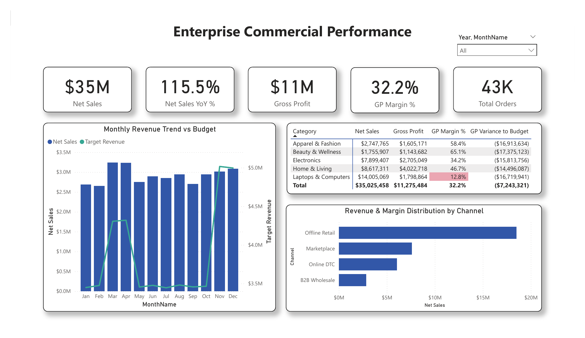
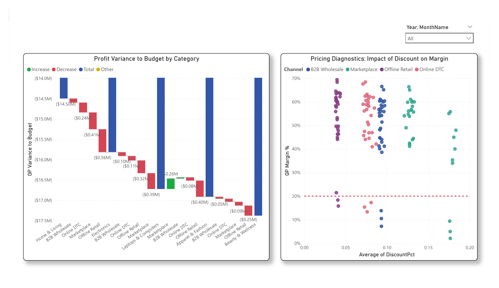
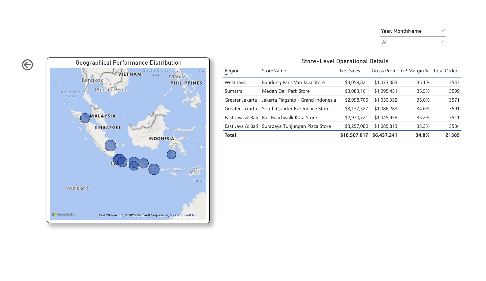

# Enterprise Omnichannel Retail: Commercial Performance & Margin Leakage

**Author:** Arik Rizki Akbar  
**Domain:** Commercial Analytics, Pricing Strategy, Financial Planning & Analysis (FP&A)  
**Stack:** Microsoft Power BI Desktop, DAX, Tabular Data Modeling (Star Schema), Power Query (M)

---

## Overview & Key Results

This project analyzes the commercial performance of an omnichannel retail network across **43,170 orders** spanning fiscal years 2024 and 2025. The business operates across four distribution channels: Physical Flagship Stores, Direct-to-Consumer (DTC) Web & Mobile App, Third-Party Marketplaces (Tokopedia, Shopee, TikTok Shop), and B2B Corporate Wholesale.

The analysis evaluates overall sales growth against budget quotas and diagnoses a critical post-campaign financial dilemma: **top-line sales grew +11.5% YoY, but gross profit margin contracted by 70 basis points (from 37.8% to 37.1%) due to promotional discount depth in third-party channels.**

### Performance Summary Table

| Commercial Metric | FY 2024 Actual | FY 2025 Actual | Absolute Variance | YoY Growth / Delta | Target Achievement (FY25) |
| :--- | :---: | :---: | :---: | :---: | :---: |
| **Gross Sales (List Price)** | \$26.85M | \$31.21M | +\$4.36M | +16.2% | - |
| **Promotional Discounts** | \$3.12M | \$4.76M | +\$1.64M | +52.5% | - |
| **Average Discount Rate** | 11.6% | 15.2% | +3.6% pts | +360 bps | - |
| **Realized Net Revenue** | **\$23.73M** | **\$26.45M** | **+\$2.72M** | **+11.5%** | **104.4% (Met Quota)** |
| **Cost of Goods Sold (COGS)** | \$14.75M | \$16.63M | +\$1.88M | +12.7% | - |
| **Gross Profit** | **\$8.98M** | **\$9.82M** | **+\$0.84M** | **+9.4%** | **97.2% (Deficit -\$285K)** |
| **Gross Margin Rate** | **37.8%** | **37.1%** | **-0.70% pts** | **-70 bps** | **Under Budget Target** |
| **Order Cancellation Rate** | 2.3% | 2.4% | +0.1% pts | +10 bps | Within normal tolerance |
| **Product Return Rate** | 4.1% | 4.3% | +0.2% pts | +20 bps | Within normal tolerance |

---

## Business Problem

During Q4 FY25 executive planning, commercial leadership celebrated meeting the annual top-line revenue target (\$26.45M achieved vs \$25.33M budget quota). However, finance flagged that realized gross profit fell short of the \$10.10M budget plan by **-\$285,000**, accompanied by margin compression across core categories.

The core analytical objective of this BI system is to:
1. Provide C-level visibility into actual vs. budget revenue and gross profit variance.
2. Isolate which channels, categories, and promotional tiers caused margin leakage.
3. Establish a repeatable Star Schema model capable of multi-grain analysis (transaction-level sales vs monthly category budgets).

---

## 1. Data Architecture & Dimensional Modeling

To ensure optimal calculation speed and clear filtering paths in Power BI (*VertiPaq engine*), data was structured into a clean Star Schema.

```text
       +-----------------------+              +-----------------------+
       |       Dim_Date        |              |      Dim_Product      |
       +-----------------------+              +-----------------------+
       | PK: DateKey           |              | PK: ProductID         |
       | Date                  |              | ProductName           |
       | Year, Month, etc.     |              | Category, SubCategory |
       +-----------+-----------+              | UnitCost, Price       |
                   |                          +-----------+-----------+
         1:N (DateKey)                                    |
                   |                                      | 1:N (ProductID)
                   v                                      v
       +--------------------------------------------------------------+
       |                          Fact_Sales                          |
       +--------------------------------------------------------------+
       | PK: SalesOrderID                                             |
       | FK: DateKey -> Dim_Date[DateKey]                             |
       | FK: ProductID -> Dim_Product[ProductID]                       |
       | FK: StoreID -> Dim_Store_Region[StoreID]                     |
       | FK: CustomerID -> Dim_Customer[CustomerID]                   |
       | OrderStatus (Delivered, Returned, Cancelled)                 |
       | Quantity, UnitPrice, DiscountPct, DiscountAmount             |
       | GrossSales, NetSales, TotalCost, GrossProfit, MarginPct      |
       +--------------------------------------------------------------+
                   ^                                      ^
         1:N (StoreID)                        1:N (CustomerID)
                   |                                      |
       +-----------+-----------+              +-----------+-----------+
       |   Dim_Store_Region    |              |     Dim_Customer      |
       +-----------------------+              +-----------------------+
       | PK: StoreID           |              | PK: CustomerID        |
       | StoreName, Channel    |              | CustomerName, Segment |
       | City, Region, Manager |              | City, JoinDate        |
       +-----------------------+              +-----------------------+

                                  +
                                  |
            1:N (DateKey)         v
       +--------------------------------------------------------------+
       |                         Fact_Budget                          |
       +--------------------------------------------------------------+
       | Composite Key: MonthKey + Category + Channel                 |
       | TargetRevenue, TargetGrossProfit                             |
       +--------------------------------------------------------------+
```

### Table Definitions
- **`Fact_Sales` (43,170 rows):** Grain is one line item per customer transaction. Includes order lifecycle stages (`Delivered`, `Returned`, `Cancelled`) to isolate recognized revenue from gross book volume.
- **`Fact_Budget` (384 rows):** Grain is monthly quota per product category and channel.
- **`Dim_Product` (31 SKUs):** Catalog metadata across Electronics, Home & Living, Apparel & Fashion, and Beauty & Wellness.
- **`Dim_Store_Region` (12 Outlets):** Master store catalog covering Physical Flagships, Digital Storefronts, Marketplace accounts, and B2B corporate distribution.
- **`Dim_Customer` (2,500 Accounts):** Consumer, Small Business, and Corporate accounts.
- **`Dim_Date` (730 Days):** Standardized calendar table for Time Intelligence calculations.

---

## 2. P&L Logic & DAX Calculations

Measures are isolated in a dedicated `_Measures` table. Key calculations account for order status to prevent cancelled orders from inflating revenue figures:

```dax
-- Realized Net Revenue
Total Net Sales = 
CALCULATE(
    SUM(Fact_Sales[NetSales]),
    Fact_Sales[OrderStatus] = "Delivered"
)

-- Budget Revenue Quota
Budget Revenue = 
SUM(Fact_Budget[TargetRevenue])

-- Variance to Budget ($)
Revenue Variance $ = 
[Total Net Sales] - [Budget Revenue]

-- Time Intelligence: Prior Year Same Period (SPLY)
Net Sales SPLY = 
CALCULATE(
    [Total Net Sales],
    SAMEPERIODLASTYEAR(Dim_Date[Date])
)

-- Realized Gross Margin (%)
Gross Profit Margin % = 
DIVIDE([Total Gross Profit], [Total Net Sales], 0)

-- Margin Degradation YoY (Basis Points)
Margin YoY Delta (bps) = 
VAR CurrentMargin = [Gross Profit Margin %]
VAR PriorMargin = CALCULATE([Gross Profit Margin %], SAMEPERIODLASTYEAR(Dim_Date[Date]))
RETURN
IF(
    ISBLANK(PriorMargin),
    BLANK(),
    (CurrentMargin - PriorMargin) * 10000
)
```

*(Complete formula definitions available in [`docs/dax_measures_library.md`](docs/dax_measures_library.md)).*

---

## 3. Margin Leakage Root-Cause Analysis

Cross-filtering dimensions against realized margin revealed three structural drivers behind the 70 bps margin contraction:

1. **Marketplace Price Competition:**  
   In FY25, discounts in third-party marketplaces averaged **19.4%** (vs 12.1% in FY24), spurred by aggressive double-digit campaign subsidies (11.11, 12.12).
2. **Category Margin Vulnerability:**  
   The Electronics category suffered the steepest erosion. While Laptop volume increased +22%, average realized gross margin fell from **21.8% to 15.3%**, failing to generate sufficient incremental dollars to offset unit discount costs.
3. **Channel Substitution:**  
   High marketplace discounting cannibalized direct webstore orders, where gross margin was 8.4 percentage points higher due to lower promotional dependency.

---

## 4. Dashboard Implementation & Visual Walkthrough

The Power BI report is organized into three stakeholder-oriented reporting tiers:

### Page 1: Executive Commercial Performance
Provides C-Suite leadership with immediate visibility into top-line revenue (\$35.0M), YoY sales pacing (+115.5%), gross margin health (32.2%), category target variances, and omnichannel distribution mix.

<p align="center">
  
</p>

### Page 2: Margin Leakage & Pricing Diagnostics
Deconstructs commercial profitability through a category/channel waterfall variance bridge, paired with an empirical discount elasticity scatter plot identifying margin-dilutive SKUs and channel discounting behavior.

<p align="center">
  
</p>

### Page 3: Regional & Store Operations
Operational drill-through mapping geographic revenue density across major Indonesian retail hubs (Greater Jakarta, West Java, East Java & Bali, Sumatra) alongside outlet-level sales, margins, and order fulfillment.

<p align="center">
  
</p>

---

## 5. Strategic Recommendations

Based on empirical variance patterns, the following commercial adjustments are recommended:

1. **Implement Hard Promotional Ceilings:** Restrict marketplace discounts on low-margin hardware (Laptops/Computers) to a maximum of 12%.
2. **Shift Promotional Budget to High-Margin Categories:** Reallocate ad spend toward Beauty & Skincare (58% standard margin) and Furniture (38% margin) where discount elasticity produces positive profit expansion.
3. **Incentivize Direct Channels:** Introduce webstore/app loyalty perks (free shipping, point multipliers) rather than price cuts to retain margin-conscious consumers within first-party channels.
